# Frontend-Architektur des AppStore – Ist-Stand

> **Stand:** 2026-10-26 · beschrieben ist der Stand von `dev`, der auf **Staging** ausgerollt ist:
> **Frontend** `dev` @ `0005672` · **self-service-ui** `dev` @ `54130c3`. Prod läuft auf älteren Ständen (Abschnitt 1.1).
> **Quellen:** Code beider Repos, Importanalyse, `nginx.conf`, `Caddyfile`, Docker- und CI-Dateien, das Kubernetes-README, die Workflows, Skripte und das Helm-Chart im deployment-Repo, `claude_docs/` beider Repos, die Image-Pins in `k8s/images/`. Dazu die laufenden Workloads und Pods beider Namespaces sowie der Argo-CD-Stand (appstore-MCP, geprüft am 2026-10-26 um 14:14 UTC).
> **Modell:** [`workspace.dsl`](workspace.dsl) (Structurizr DSL, C4). Die Diagramme sind aus diesem Modell erzeugt, über den Structurizr MCP Server (v2026.04.20, lokal; Tools `validate`, `parse`, `inspect`, `export-mermaid`).

## Kurzfassung

- Der AppStore hat **zwei Oberflächen für dieselbe Backend-API**: das **Frontend** (eigene React-SPA, TypeScript, 162 Quelldateien) und **self-service-ui** (Fork von `pfisterer/self-service-ui`, nur zu Demozwecken, eigener Anteil `web/app-store/` mit 23 Quelldateien, rund 14 % des Codes).
- **Frontend:** Die SPA macht die OIDC-Anmeldung selbst (Code + PKCE, Tokens nur im Speicher). Ausgeliefert wird sie von nginx, das in Kubernetes zugleich das Gateway für `/api` ist. Zweiter Zugang ist Moodle per LTI 1.3.
- **self-service-ui:** Ein **oauth2-proxy** (BFF) meldet bei Keycloak an. Der Browser hält nur ein Cookie, der Proxy setzt den Access-Token als Bearer, Caddy reicht `/api/app-store/*` an die API. Keine LTI-Anbindung.
- **Live-Status:** Beide Oberflächen zeigen den Fortschritt per **SSE** (nur Eigentümer) und **Polling** (Frontend: 10 s für Mitglieder, self-service-ui: 5 s, solange der Status in Bewegung ist).
- **Unterschied im Funktionsumfang:** Das Frontend hat seinen **OpenStack-VM-Pfad entfernt** (nur Pods und KubeVirt), self-service-ui bietet **weiterhin OpenStack-Zugangsdaten** an. Lifecycle-Aktionen, App-Verwaltung und Kurse gibt es nur im Frontend; self-service-ui verlinkt dorthin.
- **Prod hängt hinterher:** Das Frontend ist dort 47 Commits, self-service-ui 13 Commits hinter `dev`. Dieses Dokument beschreibt `dev`/Staging.
- **Auffälligkeiten** (Abschnitt 4): direkte API-Aufrufe aus 14 Frontend-Dateien, kein Retry nach 401, zwei kopierte Wizard- und Katalog-Logiken, Doku-Drift.

**Lesehilfe:** *Kontext → Container → Komponenten* beschreiben die **statische** Architektur (Abschnitt 2), zehn C4-Dynamic-Diagramme (Sequenz-Notation) und zwei Zustandsautomaten die **dynamische** (Abschnitt 3). Rote Pfeile mit ⚠ weichen von der dokumentierten Schichtung ab. Graue, gestrichelte Elemente sind im Code vorhanden, aber abgeschaltet.

---

## 1. Scope und Methode

| | |
|---|---|
| **Im Scope** | Die beiden Oberflächen mit ihren Web-Servern, ihre Anbindung an Keycloak, Moodle und die API sowie die Laufzeitumgebung. |
| **Außerhalb** | Innenleben von Backend-API und Worker. Sie stehen als graue Container im Modell, weil beide Oberflächen ihren Vertrag nutzen. |
| **Nur der Ist-Stand** | Beschrieben ist, was im Code von `dev` steht und auf Staging läuft. Geplantes, Idealtypisches und Entwürfe aus Issues kommen nicht vor. Wo Doku und Code auseinanderlaufen, gilt der Code, und die Abweichung steht in Abschnitt 4. |
| **Methode** | Statisch: Verzeichnis- und Importanalyse (nur Nicht-Test-Code), Konfigurationsdateien, Helm-Chart. Dynamisch: Code-Lektüre der beteiligten Module. Die **deklarierten** Image-Pins wurden aus dem deployment-Repo gelesen und mit den **laufenden** Digests beider Namespaces verglichen (appstore-MCP: `deployments`, `pods`, `staging_verdict`, `argocd_apps`). **Das Verhalten selbst wurde nicht zur Laufzeit beobachtet.** Wo eine Aussage nur aus dem Code abgeleitet ist, steht „abgeleitet“. |
| **Basis des Frontends** | Beschrieben ist `team/dev` @ `0005672`, exportiert per `git archive`; auf diesem Stand setzt auch der PR auf. Das Dokument zitiert keine Zeilennummern, weil sie mit jedem `dev`-Commit driften. |
| **Modellprüfung** | `validate`: OK. `inspect`: 42 Hinweise, davon 38 „Beziehung ohne Technologie“ (bewusst: prozessinterne Aufrufe zwischen Komponenten haben keine eigene Technologie, sonst trägt jede Kante dasselbe Label), 2 für fehlende `!docs`/`!adrs` (der zustandslose MCP-Server sieht das Dateisystem nicht) und 2 zu Keycloak und Moodle („nicht in einer Sicht“). Letztere sind ein Artefakt: Ich blende ihre Instanzen im Deployment-View bewusst aus, damit er lesbar bleibt; beide Systeme stehen in mehreren anderen Sichten. |

### 1.1 Stand je Umgebung

| | Staging (Branch `dev`) | Prod (Branch `main`) |
|---|---|---|
| **Frontend** | `sha-0005672` (26.10. 11:47 UTC), identisch mit der `dev`-Spitze, **läuft** (2 von 2 Pods) | `sha-c65eb2b` (23.10.), **47 Commits hinter `dev`**. Enthält noch den OpenStack-VM-Pfad (`SettingsOpenStackView` ist dort vorhanden) und keine Error Boundaries. |
| **self-service-ui** | `sha-54130c3` (26.10. 11:46 UTC), identisch mit der `dev`-Spitze, **läuft** (1 Pod, 2 Container). Gegenüber `1e67bd1` kam nur CI dazu (Attestation, GitHub-App-Token). | `sha-728d910` (23.10.), **13 Commits hinter `dev`**. Dort gibt es nur Katalog, Details und Deployment-Liste, **keinen** Wizard, kein Deployment-Detail, keine Zugangsdaten, Einstellungen oder Hilfe. |
| Backend | `sha-b7103c3` | `sha-4784eb5` |
| Worker | `pod-deployer` (`sha-049467e`), **kein** `vm-executor` | `pod-deployer` **und** `vm-executor` (beide `sha-b1683d8`) |
| noVNC-Proxy | per Digest gepinnt (`sha-5998abf`); **kein eigener Workload**: Der pod-deployer setzt das Image in jedes KubeVirt-VM-Deployment ein | Pin **leer**, der Chart nimmt dann ungepinnt `novnc-proxy:latest` (B13) |
| ClamAV | läuft (StatefulSet, 2 Replikate) | nicht in den Deployments |

Geprüft am 26.10. um 14:14 UTC: **Jeder laufende Digest in `appstore-staging` und `appstore-prod` entspricht dem Pin** in `k8s/images/{staging,prod}.yaml` (Branches `dev`, `main`). Alle Argo-CD-Anwendungen sind `Synced` und `Healthy` (Staging auf Revision `33fdf0f`, Prod auf `b740851`), und `staging_verdict` meldet `healthy`. Dass in Staging kein `vm-executor` läuft, folgt aus dem fehlenden Pin `worker` und ist an den Pods bestätigt. **Nicht geprüft:** `staging_verdict` konnte die öffentlichen Adressen von Frontend, API und Keycloak aus dem Cluster heraus nicht ansprechen (`ConnectError`); die Erreichbarkeit von außen ist damit nicht belegt.

---

## 2. Statische Architektur

### 2.1 Systemkontext (C4 Ebene 1)

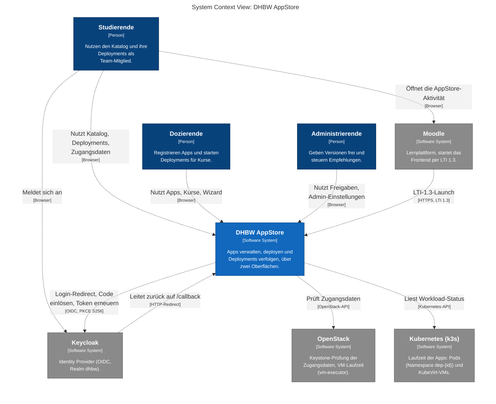

| Akteur / System | Rolle |
|---|---|
| Studierende | Sehen Katalog, ihre Deployments als Team-Mitglied und die eigenen Zugangsdaten. |
| Dozierende | Registrieren Apps (nur im Frontend), starten Deployments (Wizard), verwalten Kurse (nur im Frontend). |
| Administrierende | Freigaben (nur im Frontend), Empfehlungen, „Version festlegen“, Admin-Ansicht (Schalter pro Konto im Browser). |
| Keycloak | Anmeldung per OIDC, Realm `dhbw`. Access-Tokens laufen nach 5 Minuten ab, Refresh-Tokens rotieren (laut deployment-README). |
| Moodle | Startet das **Frontend** per LTI 1.3 und bettet es in einem iframe ein. self-service-ui ist nicht eingebunden. |
| OpenStack | Keystone-Prüfung der Zugangsdaten und VM-Laufzeit (`vm-executor`). Beide Oberflächen sprechen es **nie direkt** an. |
| Kubernetes | Laufzeit der Apps: Pods (Namespace `dep-{id}`) und KubeVirt-VMs. Beide Oberflächen sprechen es **nie direkt** an. |

### 2.2 Container (C4 Ebene 2)

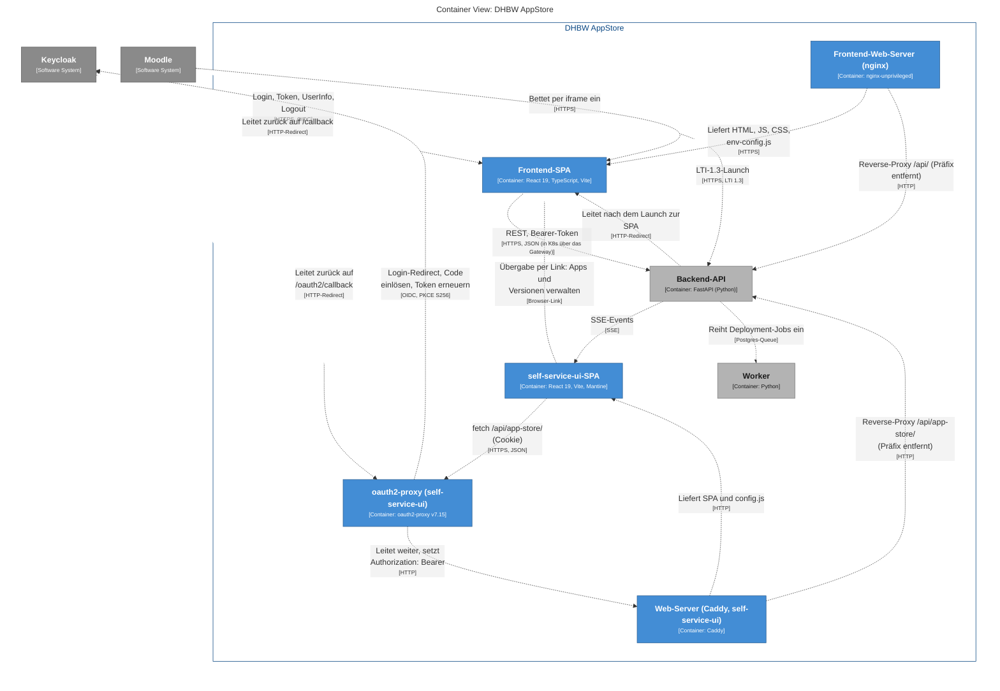

| Container | Technologie | Verantwortung |
|---|---|---|
| **Frontend-Web-Server** | `nginxinc/nginx-unprivileged` (UID 101, read-only Root) | Liefert das Build aus, schreibt beim Start `env-config.js`, CSP und Header nach `/tmp/runtime` und ist in Kubernetes das **Gateway für `/api`** (Präfix entfernt, `/api/internal/` antwortet 404, SSE-tauglich mit `proxy_buffering off` und 1 h Timeout, Body-Limit **16 MB**, Uploads ungepuffert). |
| **Frontend-SPA** | React 19, TypeScript 5.9, Vite 7 | Läuft im Browser. Zwei Build-Einstiege: `index.html` und `silent-refresh.html`. |
| **oauth2-proxy** (self-service-ui) | oauth2-proxy v7.15 | Einziger Port nach außen (:4180). Meldet bei Keycloak an (öffentlicher Client, PKCE S256), hält die Sitzung als Cookie, setzt den **Access-Token** als `Authorization: Bearer`. |
| **Web-Server** (self-service-ui) | Caddy, UID 65532, read-only Root | Liefert SPA und `config.js` (beim Start geschrieben) und leitet `/api/app-store/*` mit entferntem Präfix an die API. `/api/app-store/internal*` antwortet 404. |
| **self-service-ui-SPA** | React 19, Vite 8, Mantine 9 | Läuft im Browser. |
| Backend-API | FastAPI | Außerhalb des Scopes. **Single Source of Truth** für den API-Vertrag. |
| Worker | Python | Außerhalb des Scopes. |

**Zum Verkehrsweg des Frontends:** Logisch ruft die SPA die API unter `VITE_API_URL` auf. In Kubernetes zeigt der Ingress je Host nur auf das Frontend, und der Gateway-nginx reicht `/api` weiter. Die API hat keinen eigenen Ingress. Die Deployment-Sicht (2.6) zeigt den physischen Weg; der direkte Pfeil SPA → Backend ist die logische Sicht.

### 2.3 Komponenten des Frontends (C4 Ebene 3)

**Schichtung.** Aus Importen abgeleitet. Rot gestrichelt sind die beiden Abweichungen von der in der README beschriebenen Schichtung (Befunde B1 und B3). Die drei Querschnittsmodule rechts (i18n, Theming, Utils/Config/Types) werden von fast allen Schichten genutzt; ihre Kanten stehen in der Tabelle darunter.

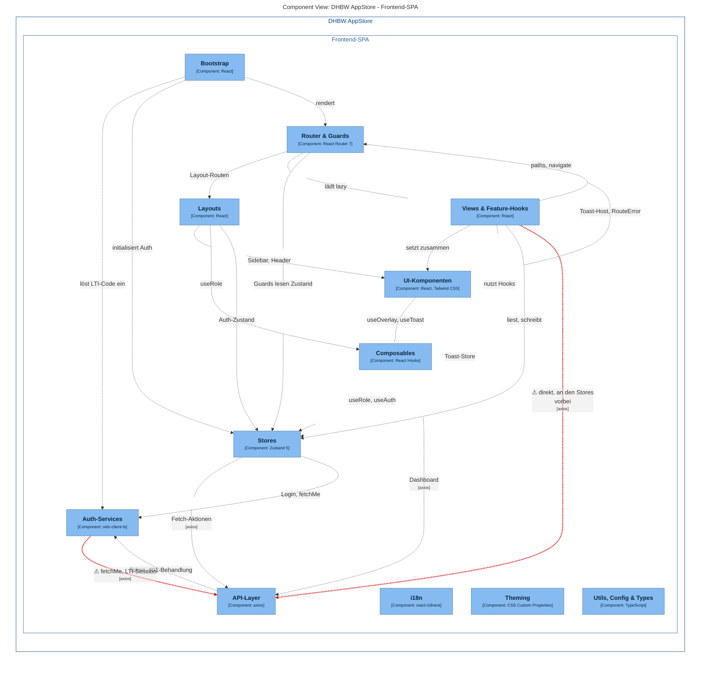

| Komponente | Ort in `src/` | Dateien / Zeilen | Verantwortung |
|---|---|---|---|
| **Bootstrap** | `main.tsx`, `bootstrap.tsx`, `App.tsx`, `env.ts` | 4 | Boot-Reihenfolge *Theme → LTI-Fragment → Auth → Render*. Auth ist entschieden, **bevor** die erste Route rendert. `env.ts` liest `window.__ENV__` (aus `/env-config.js`), dann `import.meta.env`, dann Defaults für localhost. |
| **Router & Guards** | `router/`, `components/RouteError.tsx` | 3 / 274 | Datenrouter mit `lazy()` je View. Guards laufen als **Loader**: Login nötig, nur Gäste, Rolle, Wizard-Schritt vollständig. **Error Boundaries** (`RouteError`) auf der Root-Route und auf einer pfadlosen Wrapper-Route um die Kindrouten jedes Layouts: ein Seitenfehler ersetzt nur die Seite, nicht Sidebar und Header. Unbekannte Pfade leiten auf `/`. |
| **Layouts** | `layouts/` | 7 / 408 | `AuthLayout`, `AppLayout` (Sidebar, Header), `UserLayout`. |
| **Views & Feature-Hooks** | `views/` | 72 / 10 213 | 20 Seiten. Zu jeder gehören `use*`-Hooks für Daten und Zustand (z. B. `useDeploymentDetail`, `useAppDetail`), reine Logikmodule und Teilkomponenten. **Größte Schicht, hier liegt die Fachlogik.** |
| **UI-Komponenten** | `components/` | 22 / 1 667 | `ui/` (Button, Modal, Drawer, Toast, Badge …), Variablen-Eingabe, Dropzone, Markdown-Editor und -Renderer, `RouteError`. |
| **Composables** | `composables/` | 9 / 831 | `useRole`, `useToast`, `useOverlay`, `useDashboard`, `useDeploymentPhases` u. a. |
| **Live-Stream-Client** | `composables/useDeploymentStream.ts` | 1 | SSE-Client mit eigenem Zustandsautomaten (3.7). |
| **Stores** | `stores/` | 7 / 878 | Zustand: `auth`, `app`, `course`, `deployment` (inkl. Wizard-Draft und Caches), `admin-view` (persistiert unter `appstore.adminView`), `toast`. `_request.ts` kapselt das Muster *loading → Fehler → finally*. |
| **API-Layer** | `api/` | 7 / 448 | Eine axios-Instanz (30 s Timeout) mit Token-Interceptor und 401-Behandlung, dazu je Ressource ein `*.api.ts`. |
| **Auth-Services** | `services/` | 3 / 398 | `keycloak.service` (OIDC, Tokens nur im Speicher, Single-Flight-Refresh), `auth.service` (`/users/me`, Nutzer-Cache in `localStorage`), `lti-launch` (Einmal-Code einlösen). |
| **Silent-Refresh-Seite** | `silent-refresh.html`, `silent-refresh.ts` | 2 | Callback des versteckten Iframes. Wird mitgebündelt, weil die CSP nur Skripte von `self` erlaubt. |
| **i18n** | `i18n/` | 7 / 2 229 | DE/EN, Rollenlabels, `BoldSlot` für Nutzernamen in Texten (Text statt HTML). |
| **Theming** | `theme/` | 5 / 176 | White-Label: Registry (Standard `t3`), Farbkanäle als CSS-Variablen, Titel, Favicon. Auswahl über `VITE_THEME`. |
| **Utils, Config & Types** | `utils/`, `config/`, `types/` | 15 / 5 151 | Reine Helfer, App-/Fachbereichs-Katalog (`department-catalog.ts`), API-Typen. 3 965 Zeilen sind generiert (`api.generated.ts`). |

Zusammen **162** Quelldateien und **123** Testdateien.

**Wer nutzt die Querschnittsmodule?** (aus den Importen)

| Modul | Genutzt von |
|---|---|
| i18n | Router (Guard-Texte), Layouts, Views, UI-Komponenten (`LanguageSwitch`) |
| Theming | Bootstrap, Layouts |
| Utils, Config & Types | Views, UI-Komponenten, Stores |

**Importe zwischen den Ordnern** (Anzahl Import-Anweisungen im Nicht-Test-Code, nur die tragenden Kanten):

| Von | Nach (Anzahl) |
|---|---|
| `views/` | components 64, utils 38, stores 30, composables 28, router 16, api **15**, i18n 10 |
| `components/` | utils 5, composables 3, i18n 1, stores 1, router 1 |
| `composables/` | stores 4, api **1**, services 1 |
| `stores/` | utils 3, api 3, services 2 |
| `services/` | api **2** |
| `api/` | services **1** |
| `router/` | views 21, layouts 3, stores 3, components 2 |

Fett markiert sind die Kanten, die in Abschnitt 4 als Abweichung geführt werden. Es gibt **keine** Abhängigkeit mehr von Stores auf Composables oder von UI-Komponenten auf die API.

**Laufzeit-Bausteine.** Dieselben Komponenten, aber nur die, die mit Keycloak, Moodle und dem Backend sprechen:

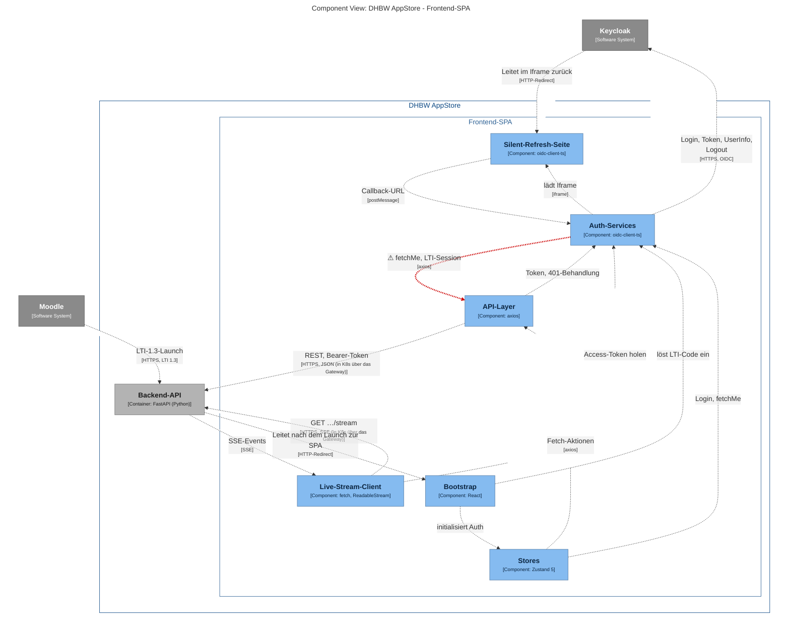

### 2.4 Build, Konfiguration und Auslieferung des Frontends

- **Build:** `tsc -b && vite build` im Multi-Stage-Dockerfile (Node 20 Alpine), danach nginx-unprivileged. Zwei Rollup-Einstiege: App und `silent-refresh`.
- **Konfiguration zur Laufzeit, nicht zur Buildzeit:** `index.html` lädt `/env-config.js` vor der App. Der Entrypoint (`docker-entrypoint.sh`) ersetzt per `envsubst` die Variablen `VITE_KEYCLOAK_URL`, `…_REALM`, `…_CLIENT_ID`, `VITE_APP_URL`, `VITE_API_URL`, `VITE_THEME`. Sonderzeichen, die ein JS-Literal oder einen Header aufbrechen könnten, lassen den Container **nicht starten** (Fail-Fast).
- **Abgeleitete Header:** Die CSP entsteht aus den Origins von Keycloak und API (`connect-src`, `frame-src`). `frame-ancestors` kommt aus `FRAME_ANCESTORS` (Standard: niemand; für Moodle muss der Moodle-Origin gesetzt werden). `silent-refresh.html` darf zusätzlich von der App selbst gerahmt werden.
- **Gateway:** Mit `API_UPSTREAM` (host:port) schreibt der Entrypoint die `/api`-Locations. Der Body ist auf **16 MB** begrenzt: Die API akzeptiert höchstens 10 MiB Dateien, das sind rund 13,4 MiB als base64 (Kommentar im Entrypoint, `.github#13`).
- **Caching:** `/assets/*` unveränderlich (1 Jahr), alles andere `no-cache`.

### 2.5 Komponenten von self-service-ui (C4 Ebene 3)

Fork von `pfisterer/self-service-ui` (Paketname `dynamic-zones-ui`, Upstream-Stand 0.8.165). **Von 164 Quelldateien (24 816 Zeilen) in `web/` gehören 23 Dateien (3 465 Zeilen) zum eigenen Bereich `web/app-store/`.** Der Rest ist Upstream-Code. Von dessen Bereichen (DNS-Zonen, Cloud-Projekte, LLM, Workspaces, API-Tokens) ist bei uns **keiner aktiv**: Das Helm-Template setzt keine der zugehörigen URLs, und `features.js` leitet die Flags ausschließlich aus diesen URLs ab. Sichtbar sind Home, der Bereich „App Store“ und der Kontomenü-Eintrag `/developer`, dessen Inhalte an den abgeschalteten Bereichen hängen (abgeleitet).

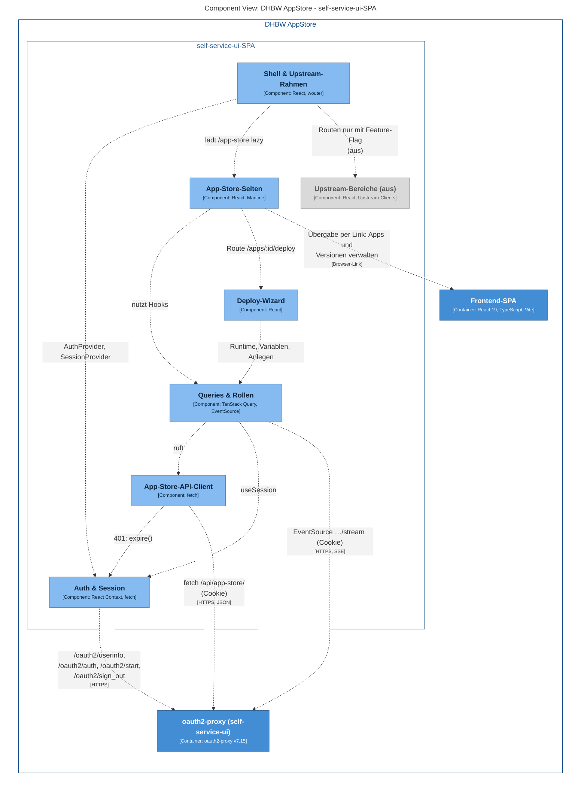

| Komponente | Ort in `web/` | Verantwortung |
|---|---|---|
| **Shell & Upstream-Rahmen** | `index.jsx`, `nav.jsx`, `header.jsx`, `features.js`, `footer.jsx`, `providers/` | Einstieg, Routing (wouter), Navigation, Header, Fehlergrenze. `features.js` entscheidet **zur Laufzeit** aus `config.js`, welche Bereiche existieren. Ein Image gilt für alle Umgebungen. |
| **Auth & Session** | `providers/auth.jsx`, `providers/session.jsx` | Identität nur vom Proxy (`/oauth2/userinfo`). Prüft die Sitzung bei **Tab-Fokus** (`/oauth2/auth`), nicht per Intervall. Bei Ablauf zeigt es einen Dialog, die Seite bleibt stehen. |
| **App-Store-Seiten** | `app-store/{catalog,app-detail,deployments,deployment-detail,credentials,settings,help}.jsx`, `shared.jsx`, `departments.js`, `admin-view.js` | Katalog mit Fachbereichs-Filter und „Empfohlen“, Details, Deployment-Liste und -Detail, **OpenStack-Zugangsdaten** (`clouds.yaml`), Admin-Einstellungen, Hilfe. |
| **Deploy-Wizard** | `app-store/wizard/` (9 Quelldateien) | Vier Schritte `config → teams → variables → summary`. Die reine Logik ist aus dem Frontend **kopiert**; der Payload von `POST /deployments/` ist derselbe. |
| **Queries & Rollen** | `app-store/queries.jsx` | TanStack-Query-Hooks, `useRole()` (`isAdminView`), Polling, Live-Log per `EventSource`. |
| **App-Store-API-Client** | `app-store/api.js` | `fetch` same-origin ohne Token, Listen seitenweise (100), `redirect: 'error'`, 401-Callback. Strukturierte Fehler mit `status` und `reason`. |
| **Upstream-Bereiche (aus)** | `dyndns/`, `projects/`, `llm/`, `gpu/`, `developer/`, `tokens/`, `swagger/` u. a. | Im Code und im Bundle (als lazy Chunks), per Feature-Flag abgeschaltet. |

**Laufzeitkonfiguration:** Der Entrypoint schreibt beim Start `config.js` (Booleans ungequotet, anderes als `true`/`false` stoppt den Container), in Kubernetes nach `/run/appconfig` (RAM-Volume), damit das Root-Dateisystem read-only bleibt. Pflicht sind `OIDC_CLIENT_ID` und `OIDC_ISSUER_URL`; bei `APP_STORE_ENABLED=true` zusätzlich `APP_STORE_UPSTREAM`. Gesetzt sind im Cluster `OIDC_*`, `APP_STORE_ENABLED`, `APP_STORE_UPSTREAM` (die API, Port 8000), `APP_STORE_FRONTEND_URL` (das Frontend) und `CONFIG_DIR`.

**Was im Frontend bleibt:** Über `APP_STORE_FRONTEND_URL` führt die UI an genau **zwei** Stellen per Link zum Frontend: „Apps verwalten“ im Katalog und „Versionen verwalten“ auf der Admin-Detailseite. Nur im Frontend gibt es außerdem Kurse, Lifecycle-Aktionen (Pausieren, Fortsetzen, Löschen, Abbrechen, Neu bereitstellen), das Pods-Panel und den LTI-Einstieg.

### 2.6 Deployment (C4 Deployment)

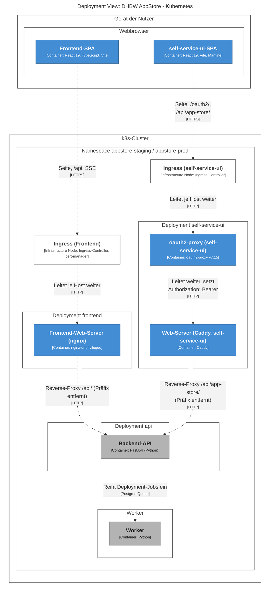

Die Pfeile zeigen den **physischen Weg**: Beide Browser-Anwendungen erreichen alles über je einen Ingress. Beim Frontend leitet der Gateway-nginx `/api` an die API, bei self-service-ui der Proxy an Caddy und dieser an die API. Keycloak und Moodle laufen im selben Namespace und sind der Lesbarkeit halber ausgeblendet. Der Worker-Knoten hat in Staging nur `pod-deployer`, in Prod zusätzlich `vm-executor` (siehe 1.1).

| Workload | Replikate | Besonderheit |
|---|---|---|
| Frontend | 2 | UID 101, read-only Root, `/tmp` als `emptyDir` |
| self-service-ui | 1 | **Ein Pod, zwei Container** (oauth2-proxy :4180, Caddy :8080), UID 65532, kein Service-Account-Token, read-only Root; Konfiguration in RAM-Volume `/run/appconfig`, Caddy-Zustand in `emptyDir` |
| API | 2 | kein eigener Ingress |

Replikatzahlen und Images aller drei Workloads wurden am 26.10. an den laufenden Deployments bestätigt (Frontend 2/2, self-service-ui 1/1 mit den Containern `oauth2-proxy` und `ui`, API 2/2). UID, read-only Root und `/tmp`-Volume stammen aus Chart und README und sind **nicht** an den Pods geprüft.

Das Deployment des Frontends und von self-service-ui rollt aus ihrem jeweiligen Repo über den **gleichen Weg** aus:

```mermaid
flowchart LR
  push["Push auf dev oder main (Frontend oder self-service-ui)"] --> ci["CI: Typecheck, Lint, Test, Security-Scan, Trivy"]
  ci --> build["Docker-Build amd64, Image-Scan"]
  build --> reg["Push nach ghcr.io (Tag sha-KÜRZEL)"]
  reg --> att["Attestation: signiert Repository, Workflow, Branch und Commit (SLSA, keyless)"]
  att --> bump["CI startet k8s-bump.yml im deployment-Repo mit einem einstündigen GitHub-App-Token"]
  bump --> ver["verify-image.sh prüft die Herkunft des Digests"]
  ver --> pr["Bump-PR: auf dev sofort gemergt, auf main von einer Person"]
  pr --> argo["Argo CD: dev wird Staging, main wird Prod"]
```

Frontend-CI laut `ci.yml`: Typecheck, Lint, Test mit Coverage-Gate **40 %** (seit frontend#80: 85 %), `npm audit`, Trivy. self-service-ui hat die Jobs `checks`, `security`, `image` und `k8s-rollout`. **Beide CIs signieren** für den gepushten Digest, welches Repository, welcher Workflow, Branch und Commit ihn gebaut hat (`actions/attest`, SLSA-Provenance, keyless). Das deployment-Repo pinnt nur Digests mit dieser Signatur: `k8s-bump.yml` ruft `verify-image.sh` auf und lehnt einen Digest ab, dessen Signatur nicht die CI der Komponente, den Branch der Umgebung und den Commit des Tags nennt. Gestartet wird der Bump mit einem **einstündigen Token der GitHub App „DHBW AppStore deploy“** (nur auf dem deployment-Repo installiert, nur *Actions: write*); der frühere `DEPLOYMENT_PAT` ist in beiden CIs abgelöst. Auf `dev` ist der Bump ein Pull Request, der sofort gemergt wird (`dev` nimmt Änderungen nur per PR an). Auf `main` ist es ein PR, den eine Person prüft und mergt. Mit der Repository-Variable `PROD_AUTO_MERGE=true` merged er sich selbst; ob sie gesetzt ist, wurde nicht geprüft.

### 2.7 Routen und Rollen

**Frontend**

| Pfad | View | Schutz |
|---|---|---|
| `/login` | `LoginView` | nur Gäste (angemeldete Nutzer → `/dashboard`) |
| `/callback` | `CallbackView` | offen (schließt den OIDC-Login ab) |
| `/`, `/dashboard`, `/apps`, `/apps/:id`, `/help`, `/deployments`, `/deployments/:id`, `/user`, `/forbidden` | Dashboard, Katalog, App-Detail, Hilfe, Deployments, Profil, Verboten | angemeldet |
| `/courses`, `/courses/:id`, `/apps/create` | Kurse, App anlegen | **Staff** (`teacher` oder `admin`) |
| `/deployment/new/config` | Wizard Schritt 1 | Staff |
| `/deployment/new/teams`, `/variables`, `/summary` | Wizard Schritte 2 bis 4 | Staff **und** Wizard-Guard (`appId`, `name`, `studentIds` im Draft, sonst Rücksprung zu Schritt 1 bzw. zum Katalog) |
| `/admin/apps`, `/admin/settings` | Freigaben, Admin-Einstellungen | `admin` |
| `*` | – | Umleitung auf `/` |

**self-service-ui** (Präfix `/app-store`, alle hinter dem Proxy angemeldet)

| Pfad | Inhalt | Rolle |
|---|---|---|
| `/apps`, `/apps/:id` | Katalog, Details (Admin-Ansicht: Version festlegen) | alle |
| `/apps/:id/deploy` | Wizard | Lehrende (Backend lehnt Studierende ab, die UI leitet sie weg) |
| `/deployments`, `/deployments/:id` | Liste (Studierende: „Meine Umgebungen“), Detail mit Status, Teams, Task-Verlauf, Live-Log | alle, Umfang nach Owner-Ansicht |
| `/credentials` | OpenStack-Zugangsdaten | Staff (Menüeintrag) |
| `/settings` | Admin-Ansicht, empfohlene Apps | `admin` (Menüeintrag) |
| `/help` | Hilfe | alle |

In beiden Oberflächen ist die Rollenprüfung **kosmetisch** (Sichtbarkeit, Weiterleitung). Das Backend entscheidet allein. Im Frontend kommt die Aktionsliste einer Deployment-Seite aus `permissions` und `actions` der API-Antwort.

### 2.8 Sicherheits-relevante Strukturentscheidungen

**Frontend**
- **Tokens nur im Speicher** (`InMemoryWebStorage`), nie in `localStorage`. Ein Reload verliert sie und holt sie über das SSO-Cookie zurück (3.3). In `localStorage` liegen das Nutzerobjekt (`user`, u. a. E-Mail und Rolle), der Schalter der Admin-Ansicht und kurzzeitig der OIDC-Login-Zustand (`oidc.*`, enthält den PKCE-Verifier).
- **CSP** ohne Inline-Skripte und ohne `eval` (`script-src 'self'`). Deshalb ist auch die Silent-Refresh-Seite ein eigenes Bundle.
- **HTML nur mit Begründung:** Eine ESLint-Regel verlangt für `dangerouslySetInnerHTML` eine Ausnahme. Es gibt **fünf** Stellen: der Markdown-Renderer (marked, mit DOMPurify), `translateHtml` in `AddAppsView` und `AddMembersModal`, die JSON-Anzeige im Task-Verlauf und `VariableCard`. Nutzernamen in Texten laufen über `BoldSlot` als Text.
- **LTI:** Der Einmal-Code steht im URL-**Fragment** (gelangt nicht in Logs oder Referer), wird sofort aus der Adresszeile entfernt und ist ohne das HttpOnly-Binding-Cookie wertlos. Ein Session-Token in der URL wird nicht mehr akzeptiert.

**self-service-ui**
- **Der Browser hält nie ein Token**, nur das Cookie des Proxys (`Secure`, `SameSite=Lax`). Der Proxy erneuert die Sitzung minütlich (`--cookie-refresh=1m`), solange der Tab genutzt wird.
- **Der Proxy reicht den Access-Token weiter**, nicht den ID-Token (`injectRequestHeaders`). Das Backend prüft `azp` gegen `OIDC_ALLOWED_CLIENTS` und `aud` gegen `appstore-api`. Der Keycloak-Client ist **öffentlich**; der Proxy bekommt einen Platzhalter als `client-secret`, den Keycloak ignoriert.
- **Der Proxy trifft keine Zugriffsentscheidung:** `--email-domain=*` und `insecureAllowUnverifiedEmail: true`. Wer am Realm angemeldet ist, kommt durch; alles Weitere entscheiden Keycloak und die API.
- **API-Aufrufe ohne Sitzung** bekommen 401 statt einer Login-Seite (`--api-route=^/api/`). `fetch` ist zusätzlich mit `redirect: 'error'` abgesichert.
- **Dev-Anmeldung** (`DUMMY_AUTH`) gibt es nur in Dev-Builds (`import.meta.env.DEV`); keine Laufzeitkonfiguration kann sie in einem Image einschalten.
- **Nicht in Moodle einbettbar:** `frame-ancestors 'none'` und `X-Frame-Options: DENY` am Caddy.
- **Weiter gefasst, als der BFF-Betrieb braucht:** Die CSP des Caddy erlaubt in `script-src` und `connect-src` zusätzlich `https://*.dhbw.cloud` (Kommentar im Caddyfile: Spielraum für die Konfiguration vor dem BFF-Umbau). Siehe B11.

### 2.9 Die beiden Frontends im Vergleich

| Aspekt | Frontend | self-service-ui |
|---|---|---|
| Herkunft | eigenes Repo | Fork von `pfisterer/self-service-ui`, eigener Anteil rund 14 % |
| Sprache, Stack | TypeScript, React 19, Vite 7, Tailwind, Zustand, React Router 7, axios | JavaScript (JSX), React 19, Vite 8, Mantine 9, TanStack Query, wouter, `fetch` |
| Typen für die API | aus OpenAPI generiert (teilweise veraltet) | keine; handgeschriebener Client |
| Anmeldung | die SPA selbst (OIDC Code + PKCE, `oidc-client-ts`) | oauth2-proxy (BFF) |
| Token im Browser | ja, im Speicher | nein |
| Token ans Backend | die SPA setzt den Bearer | der Proxy setzt den Bearer |
| Auslieferung | nginx, zugleich Gateway für `/api` | Caddy hinter dem Proxy, `/api/app-store/` |
| Moodle, LTI | ja | nein |
| Live-Fortschritt | SSE per `fetch` mit Reconnect (Eigentümer), Polling 10 s (Mitglieder) | SSE per `EventSource`, **kein** Reconnect (Eigentümer), Polling 5 s bei laufendem Status (alle) |
| Wizard | Konfiguration → Teams → Variablen → Zusammenfassung | gleiche Schritte, Logik kopiert |
| Lifecycle-Aktionen, App-Verwaltung, Kurse | ja | nein, verlinkt ins Frontend |
| OpenStack-VM-Pfad | **entfernt** (nur Pods und KubeVirt) | Zugangsdaten-Seite und Credential-Wahl im Wizard noch vorhanden |
| Replikate | 2 | 1 |
| Stand in Prod | 47 Commits hinter `dev` | 13 Commits hinter `dev` |

---

## 3. Dynamische Architektur

Zehn Abläufe als C4-Dynamic-Diagramme (Sequenz-Notation), dazu zwei Zustandsautomaten für die Echtzeit-Mechanismen des Frontends. Die Schrittnummern entsprechen dem Code-Pfad; **Beobachtungen** unter den Diagrammen sind aus dem Code abgeleitet.

### Frontend

#### 3.1 Einstiegspfade beim Start

`bootstrap()` entscheidet **vor** dem ersten Render, wie die Sitzung zustande kommt:

| Pfad | Auslöser | Ergebnis |
|---|---|---|
| LTI | URL-Fragment `#lti=1&code=…` | Code einlösen, Stub-User, Sitzungs-Token statt Keycloak (3.5) |
| Dev-Brücke | `?sso_handoff=<mail>`, nur in `import.meta.env.DEV` | Fester Dev-Token, kein Keycloak |
| Regulär | sonst | `auth.initialize()` mit stiller Anmeldung (3.3) |

#### 3.2 Anmeldung (OIDC Authorization Code + PKCE)

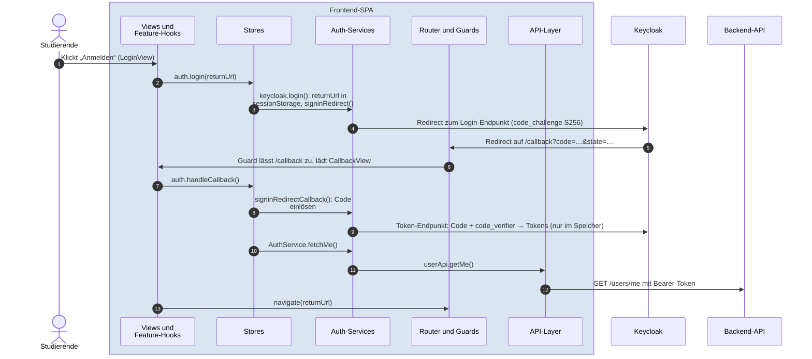

**Beobachtungen**
- Die zurückgesprungene Seite lädt die SPA **komplett neu** (`/callback?code=…`). Der Login-Zustand (`state`, PKCE-Verifier) überlebt das im `localStorage` (Standard von `oidc-client-ts`, Präfix `oidc.`); die Tokens selbst liegen nur im Speicher.
- `handleCallback()` ist über `callbackInFlight` gegen Doppelausführung geschützt. Hintergrund (Code-Kommentar): Ein Authorization-Code ist einmalig, und React StrictMode führt Effekte in Dev doppelt aus. Keycloak würde bei der zweiten Einlösung die ganze Sitzung widerrufen.
- Das Backend wird erst nach dem Token-Tausch gefragt (`GET /users/me`). Die Rolle des Nutzers kommt von dort.

#### 3.3 Seiten-Reload: stille Wiederherstellung

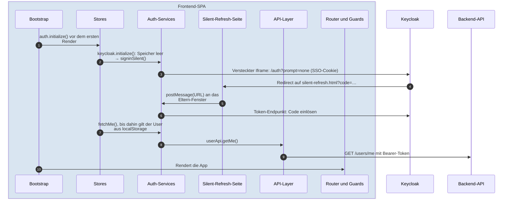

**Beobachtungen**
- Nach einem Reload ist der Speicher leer. `signinSilent()` hat dann **keinen** Refresh-Token zur Hand und nimmt den Weg über den versteckten Iframe (`prompt=none`, SSO-Cookie). Während der laufenden Sitzung erneuert `oidc-client-ts` dagegen mit dem Refresh-Token (Prüfung im Paket: `signinSilent` nutzt `user.refresh_token`, sonst den Iframe). `automaticSilentRenew` ist an.
- Parallel zum Token-Holen zeigt die UI den Nutzer aus `localStorage` (`user`), bis `/users/me` antwortet.
- **Abgeleitet, nicht zur Laufzeit geprüft:** `bootstrap()` ruft `auth.initialize()` für jeden Pfad auf, also auch für `/callback`. Der Guard dagegen schließt `/callback` und `/login` aus. Auf `/callback` kann deshalb parallel zur Code-Einlösung ein überflüssiger stiller Anmeldeversuch laufen.

#### 3.4 Standard-Datenfluss mit Token und 401-Behandlung

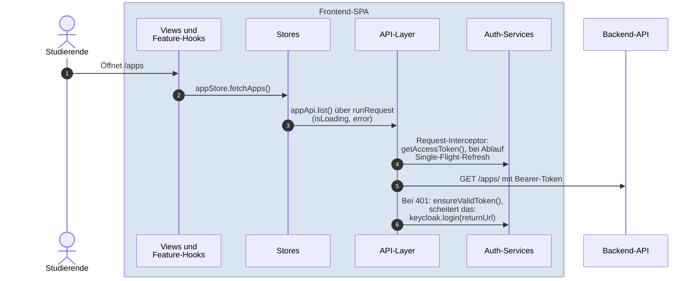

**Beobachtungen**
- **Single-Flight:** Eine Seite löst beim Laden fünf oder mehr Requests gleichzeitig aus. Ohne Bündelung würde jeder einen eigenen Iframe-Refresh starten. Deshalb teilen sich alle denselben `refreshInFlight`-Promise (`keycloak.service.ts`).
- Ebenso dedupliziert sind `auth.initialize()` und `auth.fetchMe()` (Promise-Cache im Store).
- **Kein automatischer Retry:** Antwortet die API mit 401, versucht der Interceptor `ensureValidToken()`. Gelingt das, wird der **fehlgeschlagene Request nicht wiederholt**; der Fehler geht an den Aufrufer. Misslingt es, löscht er den Nutzer-Cache und leitet auf den Keycloak-Login um. Einen Retry-Pfad gibt es im Code nicht (Befund B5).
- Das Muster *Aufruf → `isLoading`/`error`* kapselt `runRequest`. Gewollt ausgenommen sind die Auth-Aktionen (echte Keycloak-Fehlertexte) und das Status-Polling (3.8).

#### 3.5 Start aus Moodle (LTI 1.3)

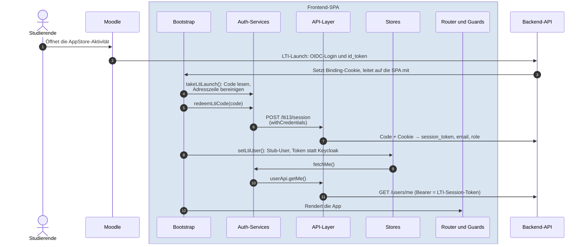

**Beobachtungen**
- Der Code wird **nur** zusammen mit dem Cookie eingelöst, das der Launch im selben Browser gesetzt hat. Ein Link mit fremdem Code meldet niemanden an.
- Nach dem Einlösen ersetzt der LTI-Sitzungstoken das Keycloak-Token (`getAccessToken()` liefert ihn). `ensureValidToken()` gibt für LTI-Sitzungen immer `true` zurück: Es gibt **keine Erneuerung** des kurzlebigen Tokens. Läuft es ab, antwortet die API mit 401, ohne dass der Interceptor umleitet (abgeleitet).
- Läuft die App im Moodle-iframe, kann `localStorage` blockiert sein. Alle Zugriffe in `auth.service` sind gekapselt und fallen auf eine reine Speicher-Sitzung zurück.
- Der Stub-User bleibt stehen, falls `/users/me` scheitert. Laut Code-Kommentar ist das besser, als einen LTI-Nutzer in den unangemeldeten Zustand zurückzuwerfen.

#### 3.6 Deployment starten (Wizard)

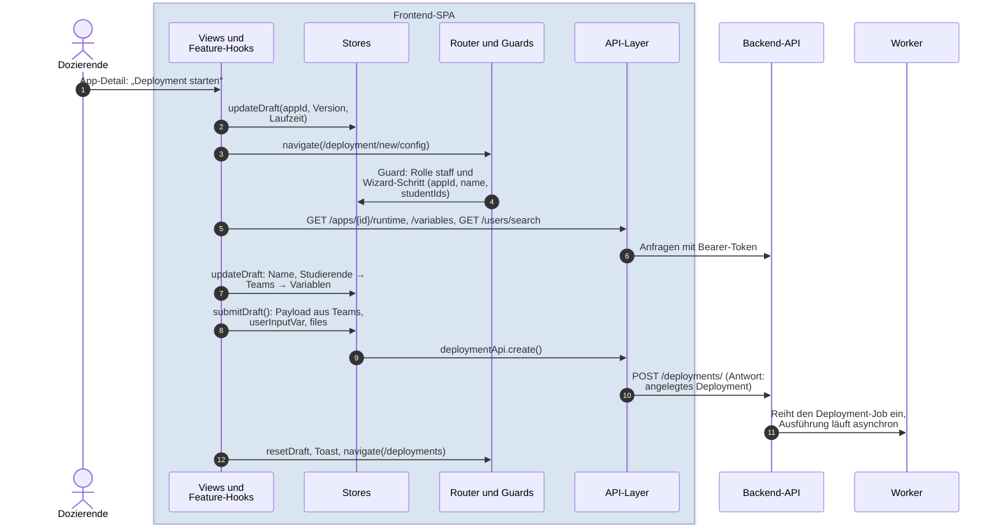

**Beobachtungen**
- **Reihenfolge der Schritte laut Code:** App-Detail → Konfiguration (`/config`) → Teams (`/teams`) → Variablen (`/variables`) → Zusammenfassung (`/summary`). Die README nennt „Variablen“ vor „Gruppen“ und weicht damit ab (Befund B6).
- Der **Wizard-Zustand ist ein Draft im Deployment-Store**, nicht im URL. Ein Reload oder Deep-Link ohne Draft wird vom Guard auf Schritt 1 bzw. auf den Katalog zurückgeleitet.
- `submitDraft()` baut den Payload: Teams (`groupNames` × `assignments`, Fallback: gleichmäßige Aufteilung nach `groupCount`), `userInputVar` (nur noch der Schlüssel `terraform`, der Name ist historisch), Dateien unter `files`, dazu `resources` und `network`. Leere Werte werden **weggelassen**, damit HCL-Defaults greifen.
- Es gibt **keine Credential-Wahl mehr**: Das Frontend kennt nur noch die Laufzeiten `kubernetes` und `kubevirt-vm`, beide im Cluster. Der Typwert `openstack-vm` ist entfernt (#93, #96); eine unbekannte Laufzeit wird wie `kubernetes` beschriftet.
- Bei Fehlern bleibt der Draft erhalten. Bei Erfolg: `resetDraft`, Toast, Weiterleitung auf `/deployments`. Die **Ausführung ist asynchron** (Worker); den Fortschritt zeigt 3.7 bzw. 3.8.

#### 3.7 Live-Fortschritt für Eigentümer und Dozierende (SSE)

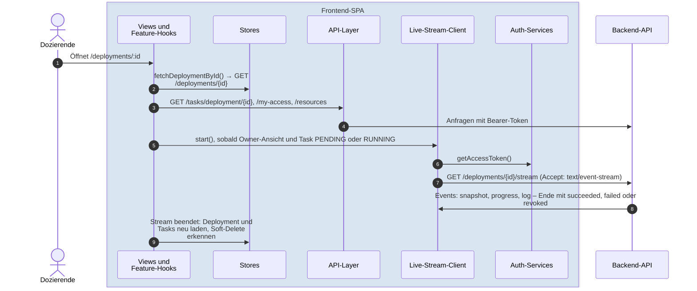

Verbindungs-Zustandsautomat des Stream-Clients (`useDeploymentStream.ts`):

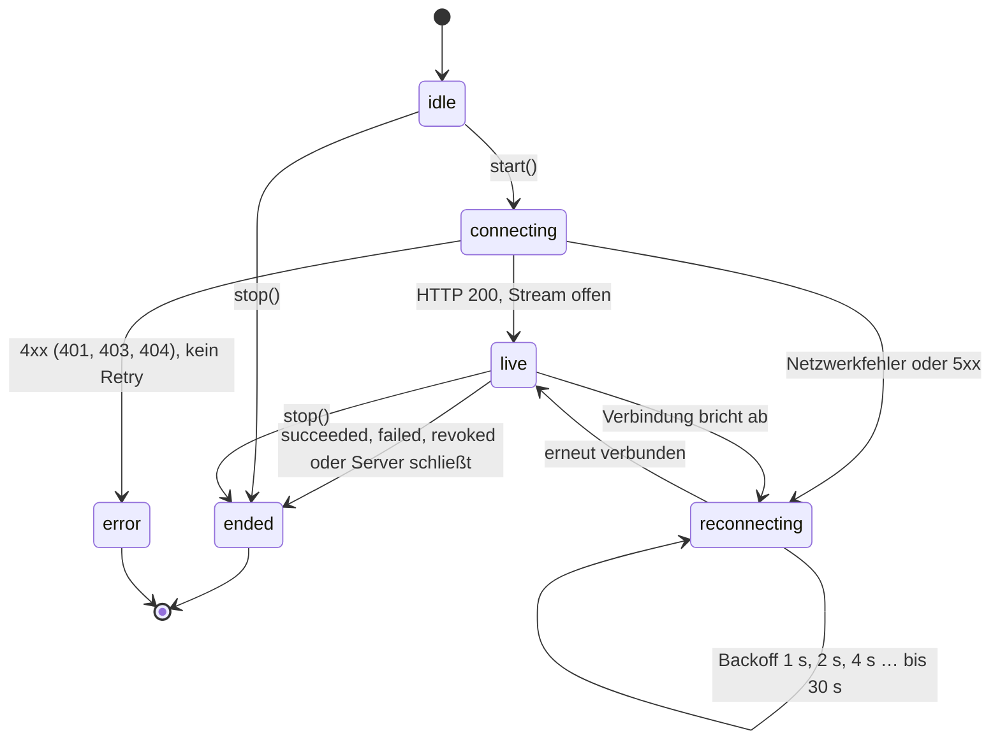

**Beobachtungen**
- **Warum `fetch` statt `EventSource`:** `EventSource` kann keinen `Authorization`-Header senden. Die Konsequenz ist ein eigener Parser (Frames bei `\n\n`, Kommentarzeilen als Keepalive) und eigener Reconnect.
- Der Stream wird nur gestartet, wenn die **Owner-Ansicht** gilt **und** die aktive Task `PENDING` oder `RUNNING` ist. Er endet mit der Task: Dann lädt die Seite Deployment, Tasks, Zugangsdaten und Ressourcen neu.
- **Soft-Delete-Erkennung:** Nach einem erfolgreichen Destroy liefert der Refetch kein Deployment mehr. Die Seite zeigt Erfolg und springt zur Liste. Existiert die Zeile noch, war der Destroy fehlgeschlagen.
- **Puffer:** Der Client hält höchstens 100 Logzeilen, zählt aber alle. Ein `overflow`-Event schreibt einen Warnhinweis in den Log. Der Snapshot übernimmt Fortschritt und Phase nur bei **aktiver** Task, damit der alte 100 %-Stand nicht kurz aufblitzt.
- **Phasenliste:** Vor dem ersten Event zeigt der Stepper eine statische Liste der Pod-Phasen (`useDeploymentPhases`, Standard **7** Schritte, je Task-Typ für Deploy, Destroy, Pause, Resume und Redeploy). Sobald ein Event eintrifft, gilt die Liste, die der Worker mitschickt. Laut Code-Kommentar spiegeln die Tabellen die Pod-Phasen des Workers; die früheren Packer-Phasen mit Template-Suffix sind entfernt.
- Das 401-Handling des Interceptors greift hier **nicht**, weil der Client `fetch` direkt nutzt. `getAccessToken()` erneuert ein abgelaufenes Token aber vor jedem Verbindungsaufbau.
- Zusätzlich fragt die Detailseite **alle 10 s** die Workloads aus dem Cluster ab, solange ein Pod nicht bereit ist oder sich einrichtet.

#### 3.8 Statusanzeige für Mitglieder (Polling)

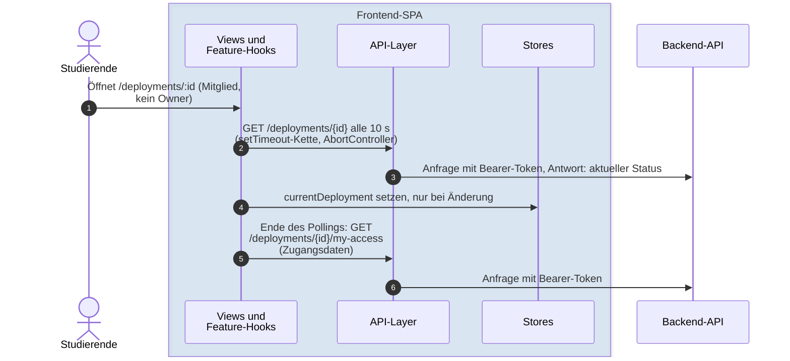

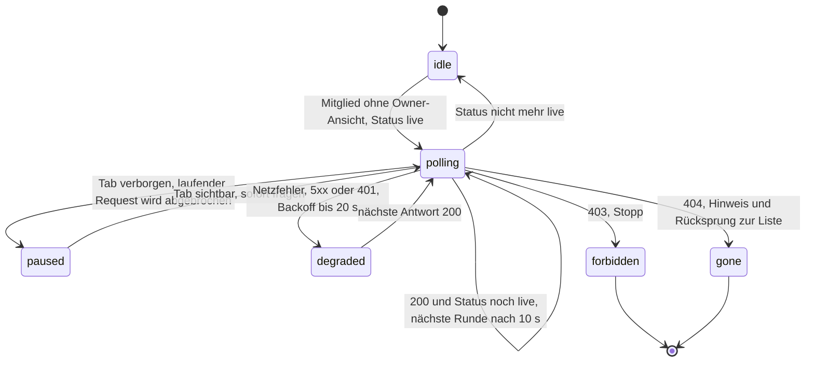

**Beobachtungen**
- Studierende bekommen den Stream **nicht**, weil er rohe Worker-Logs enthält und Eigentümern vorbehalten ist. Deshalb dieser zweite Mechanismus.
- **Verkettete `setTimeout`s** statt `setInterval`: Es können sich keine Requests überlappen. Der Store wird nur bei **inhaltlicher** Änderung beschrieben (`JSON.stringify`-Vergleich) und nur für die eigene `deploymentId`.
- Bewusst **nicht gepollt** werden `pausing`, `resuming`, `destroying` (zentral über `isLiveStatus`).
- Die Zugangsdaten gibt es nur unter `/my-access`. Sie werden nachgeladen, sobald das Polling endet.

#### 3.9 Querschnitts-Mechanismen des Frontends

| Mechanismus | Wo | Wirkung |
|---|---|---|
| Single-Flight-Refresh | `keycloak.service.ts` | Alle gleichzeitigen 401-/Ablauf-Fälle teilen sich **einen** Token-Refresh. |
| Promise-Dedupe | `auth.store.ts` (`initialize`, `fetchMe`) | Router-Guard, App-Start und Views lösen die Initialisierung nicht mehrfach aus. |
| `runRequest` | `stores/_request.ts` | Einheitliches Muster aus `isLoading`, Fehlertext und `finally`. |
| Error Boundaries | `router/index.tsx`, `RouteError.tsx` | Ein Render-, Lazy-Import- oder Loader-Fehler ersetzt nur die Seite. Der Fehler geht per `console.error` ins Log, nie in die Seite. |
| Admin-Ansicht | `stores/admin-view.store.ts` | Schalter pro `userId` in `localStorage`; steuert nur UI-Elemente (`isAdminView`). |
| Abbruch beim Verlassen | `useDeploymentStream`, `useDeploymentStatusPolling` | `AbortController` beim Unmount, Timer werden geräumt. |

### self-service-ui

#### 3.10 Anmeldung über den oauth2-proxy (BFF)

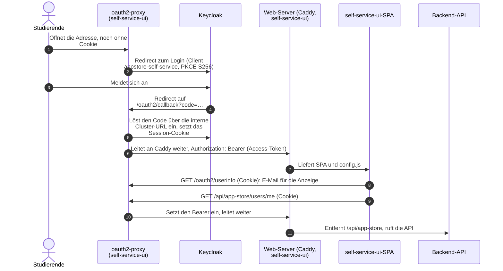

**Beobachtungen**
- **Jede** Anfrage läuft zuerst durch den Proxy. Ohne Cookie leitet er zu Keycloak (`loginURL` ist die öffentliche Adresse). Den Code löst er **im Cluster** über die interne Keycloak-Adresse ein (`redeemURL`, `jwksURL`), `skipDiscovery: true`. Der Issuer bleibt die öffentliche Adresse, weil die Tokens ihn so nennen.
- Die SPA muss deshalb **keinen** OIDC-Code enthalten. Laut `app-store.md` war das der Grund: Jeder Upstream-Merge hätte ihn wieder aufgerissen.
- Die SPA holt sich nur die E-Mail zur Anzeige (`/oauth2/userinfo`). Der Bearer wird **serverseitig** eingesetzt, die SPA sieht ihn nie.
- **Abmelden** geht über `/oauth2/sign_out`, danach über den Keycloak-Endpunkt `logout`. Nur das Proxy-Cookie zu löschen, ließe die SSO-Sitzung stehen und würde sofort wieder anmelden.

#### 3.11 Sitzung läuft ab

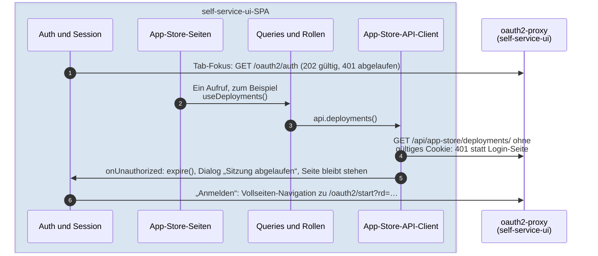

**Beobachtungen**
- Es gibt **bewusst keinen Intervall-Check**: Der Proxy erneuert die Sitzung bei jeder Anfrage, ein periodischer Check wäre ein Keep-Alive, und ein liegengelassener Tab bliebe ewig angemeldet. Geprüft wird nur beim Fokus-Wechsel, weil Sitzungen meist ablaufen, während niemand hinsieht.
- Zwei Auslöser führen zum selben Dialog: die Probe (`202` gültig, `401` abgelaufen) und ein 401 auf einen Datenaufruf. Nur ein ausdrückliches 401 zählt als „abgemeldet“; 404 oder 502 der Probe lösen **keinen** Dialog aus.
- Die Seite bleibt stehen, damit Eingaben in offenen Dialogen nicht verloren gehen. Der Dialog lässt sich wegklicken und erscheint bei einem neuen Fehler wieder.

#### 3.12 Deployment-Detail: Status-Polling und Live-Log

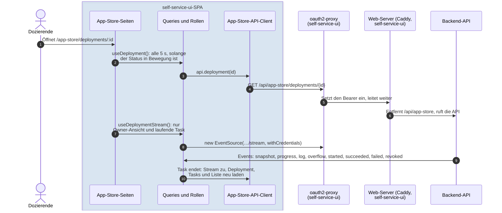

**Beobachtungen**
- **Polling:** `GET /deployments/{id}` alle 5 s, solange der Status in Bewegung ist, nicht im Hintergrund-Tab; ein fehlgeschlagener Poll behält den letzten Stand. Die Liste fragt alle 15 s, solange ein Eintrag in Bewegung ist.
- **Live-Log** nur in der Owner-Ansicht und nur bei laufender Task, per `EventSource` mit Cookie. Ein Pfad **durch Proxy und Caddy**: Dass beide den Stream unverändert tragen, ist laut HANDOVER noch **nicht auf Staging geprüft** (Befund B9).
- Bricht der Stream einmal ab, bleibt er unten (`broken`). Das Polling trägt den Status weiter; es gibt keinen Reconnect. Der Code-Kommentar begründet das damit, dass ein einmal gescheiterter Stream eher auf einen Proxy hindeutet, der ihn nicht tragen kann, als auf einen Aussetzer.
- Mit dem Ende der Task schließt die UI den Stream und lädt Deployment, Tasks und Liste neu.

#### 3.13 Wizard von self-service-ui

Gleiche vier Schritte und gleicher Payload wie im Frontend, deshalb ohne eigenes Diagramm. Unterschiede: Die reine Logik (`teams.js`, `students.js`, `variables.js`, `payload.js`) ist aus `frontend/src/views/new-deployment/` **kopiert**. Bei Apps mit der Laufzeit `openstack-vm` verlangt der Wizard ein **verifiziertes OpenStack-Credential** (Auswahl im Wizard, automatisch bei genau einem). **Nicht dabei** sind Werthilfen für `@openstack:`-Marker und eine eigene Oberfläche für Mehr-Image-Packer-Apps.

---

## 4. Auffälligkeiten im Ist-Stand

Sortiert nach Relevanz. Belege sind Dateien im Repo; **keine** der Aussagen wurde zur Laufzeit geprüft.

| # | Befund | Beleg | Einordnung |
|---|---|---|---|
| **B1** | **Views und ein Composable rufen die API direkt auf**, an den Stores vorbei: 14 Dateien im Frontend importieren `*.api` (13 in `views/`, 1 in `composables/`). | z. B. [`useDeploymentDetail.ts`](../../src/views/deployment-detail/useDeploymentDetail.ts), [`useStudentDirectory.ts`](../../src/views/new-deployment/useStudentDirectory.ts), [`useDashboard.ts`](../../src/composables/useDashboard.ts) | Die README beschreibt *View → Store → API*. Teils bewusst (das Polling vermeidet `runRequest`, damit die Seite nicht flackert). Entweder die Schichtregel anpassen („Daten-Hooks dürfen die API nutzen“) oder die Aufrufe in Stores ziehen. |
| **B2** | **Zwei Kopien derselben Fachlogik:** Fachbereichs-Katalog (`department-catalog.ts` ↔ `departments.js`) und Wizard-Logik (Teams, Studierende, Variablen, Payload) liegen in beiden Repos. | [`department-catalog.ts`](../../src/config/department-catalog.ts), `self-service-ui/web/app-store/departments.js`, `app-store.md` | Das ist dort ausdrücklich so dokumentiert („Neue App → in beiden Repos eintragen“). Der Abgleich ist Handarbeit; eine Änderung an nur einer Seite lässt die Oberflächen auseinanderlaufen. |
| **B3** | **Ordnerzyklus `api/` ⇄ `services/` im Frontend:** `axios.ts` holt Tokens aus `keycloak.service`; `auth.service` und `lti-launch` rufen die API. | [`axios.ts`](../../src/api/axios.ts), [`auth.service.ts`](../../src/services/auth.service.ts), [`lti-launch.ts`](../../src/services/lti-launch.ts) | Kein **Modul**zyklus (`keycloak.service` importiert die API nicht), aber die Ordnergrenze ist unscharf. |
| **B4** | **Der SSE-Client des Frontends umgeht axios** und damit das 401-Handling. | [`useDeploymentStream.ts`](../../src/composables/useDeploymentStream.ts) | Bewusst (Header und Stream-Kontrolle). Ein abgelaufenes Token wird vor dem Verbindungsaufbau erneuert; ein 401 mitten im Stream endet als `error` ohne Login-Umleitung. |
| **B5** | **Kein Retry nach erfolgreichem Token-Refresh bei 401** (Frontend). | [`axios.ts`](../../src/api/axios.ts) | Der erste Request nach einer Ablaufgrenze kann als Fehler beim Nutzer landen, obwohl die Sitzung gültig ist. Ein Retry mit `config._retry` wäre eine kleine Änderung. |
| **B6** | **Dokumentations-Drift im Frontend:** Die README nennt die Wizard-Reihenfolge Konfiguration → Variablen → Gruppen → Zusammenfassung; der Code geht Konfiguration → **Teams** → **Variablen** → Zusammenfassung. Das HANDOVER nennt ein Coverage-Gate von 60 % für `main`, `ci.yml` erzwingt `MIN_COVERAGE=40` auf allen Branches (behoben mit frontend#80: 85 %, Doku angeglichen). Das HANDOVER führt den Pods-Cutover (AP8) noch als offen, `2026-react-pods.md` meldet ihn als vollzogen. Das HANDOVER weist selbst darauf hin, dass seine Abschnitte teils den Stand vor der VM-Entfernung beschreiben. | [`NewDeploymentConfigView.tsx`](../../src/views/NewDeploymentConfigView.tsx) (geht zu `paths.deploymentTeams`), [`useVariableForm.ts`](../../src/views/new-deployment/useVariableForm.ts) (geht zu `paths.deploymentSummary`), [`ci.yml`](../../.github/workflows/ci.yml), [`HANDOVER.md`](../../claude_docs/HANDOVER.md) | Reine Textpflege, aber die README ist der Einstieg für neue Mitglieder. |
| **B7** | **API-Vertrag im Frontend nicht aktuell:** `openapi.json` und `api.generated.ts` kennen weder `/admin/apps/{id}/recommended` noch `/deploy-version` (#55, #56); der Contract-Test prüft diese Endpunkte daher nicht. Zusätzlich gibt es laut CI-Kommentar rund 157 ESLint-Warnungen, überwiegend `any` aus handgepflegten Typen. self-service-ui hat gar keine Typen für die API. | [`HANDOVER.md`](../../claude_docs/HANDOVER.md), [`ci.yml`](../../.github/workflows/ci.yml) | Beide Clients sind in diesem Punkt nur durch ihre eigenen Tests gesichert. |
| **B8** | **Abgeleitet, nicht geprüft:** Auf `/callback` startet `bootstrap()` die Initialisierung mit stiller Anmeldung, obwohl der Guard diese Route ausnimmt (siehe 3.3). | [`bootstrap.tsx`](../../src/bootstrap.tsx), [`guards.ts`](../../src/router/guards.ts) | Im Netzwerk-Log eines Logins prüfen, ob ein zusätzlicher `prompt=none`-Aufruf erscheint. |
| **B9** | **SSE durch Proxy und Caddy nicht live geprüft** (self-service-ui). Laut HANDOVER steht „echter Live-Lauf des SSE-Logs auf Staging“ aus. Der Client baut nach einem Abbruch nicht neu auf. | `self-service-ui/claude_docs/HANDOVER.md`, `queries.jsx` | Wenn der Pfad den Stream puffert, fällt das Live-Log still auf Polling zurück; ein Fehler wäre für Nutzer kaum sichtbar. |
| **B10** | **Die beiden Oberflächen unterscheiden sich beim OpenStack-Pfad:** Das Frontend hat ihn mit #67 entfernt (Credentials-Seite, Picker, Quota-Kachel, Infrastructure-Tab), self-service-ui bietet Zugangsdaten und Credential-Wahl weiterhin an. In Prod läuft außerdem ein `vm-executor`, in Staging nicht. | [`HANDOVER.md`](../../claude_docs/HANDOVER.md), `self-service-ui/web/app-store/api.js`, `wizard/wizard.jsx` | Ob das Backend die `/me/openstack-credentials`-Endpunkte noch anbietet, wurde **nicht geprüft**. |
| **B11** | **Lockere oder tote Konfiguration im Caddy von self-service-ui:** Die CSP erlaubt `https://*.dhbw.cloud` in `script-src` und `connect-src` (Kommentar: „can be dropped … once the BFF migration is complete“). Die Routen `/api/dyndns/`, `/api/projects/` und `/api/llm/` zeigen auf Standard-Upstreams (`dynamic-zones:8082` u. a.), die es bei uns nicht gibt. | `self-service-ui/Caddyfile` | Wirkt nicht, solange keine URL gesetzt ist, ist aber Fläche ohne Nutzen. |
| **B12** | **Prod ist für self-service-ui laut HANDOVER nicht fertig vorbereitet:** Der Keycloak-Client im Live-Realm von Prod steht dort als offener Punkt („Promotion nach main/Prod“). Der Prod-Stand hat außerdem nur Katalog, Details und Liste. | `self-service-ui/claude_docs/HANDOVER.md`, 1.1 | Ob der Client inzwischen existiert, wurde **nicht geprüft**. |
| **B13** | **Prod hat keinen Pin für den noVNC-Proxy:** In `k8s/images/prod.yaml` ist `novncProxy` leer. Der Chart setzt dann `K8S_VNC_PROXY_IMAGE` auf `<registry>/novnc-proxy:latest`, also ungepinnt. Staging pinnt das Image per Digest. Das Image läuft nicht im `appstore-*`-Namespace, sondern wird vom pod-deployer in jedes KubeVirt-VM-Deployment eingesetzt. | `k8s/charts/appstore/templates/_helpers.tpl` und `pod-deployer.yaml` im deployment-Repo, `k8s/images/{staging,prod}.yaml` | Laut Chart-Kommentar bis zum ersten Bump gewollt („as before“). Ob Prod KubeVirt-VMs tatsächlich startet, wurde nicht geprüft. |

---

## 5. Modell pflegen

Das Modell liegt in [`workspace.dsl`](workspace.dsl). Es enthält 3 Personen, 4 Fremdsysteme, 7 Container (Frontend-Web-Server, Frontend-SPA, oauth2-proxy, Caddy, self-service-ui-SPA, Backend-API, Worker), 14 Komponenten des Frontends, 7 Komponenten von self-service-ui und 16 Sichten (Kontext, Container, 3 Komponenten-Sichten, 10 Dynamic-Sichten, Deployment).

```bash
# Structurizr MCP Server lokal starten (nur localhost)
docker run -d --rm --name structurizr-mcp -p 127.0.0.1:3000:3000 -e PORT=3000 structurizr/mcp -dsl -mermaid -plantuml
```

```bash
# als MCP-Server in Claude Code registrieren (Tools: validate, parse, inspect, export-mermaid, export-plantuml, export-c4plantuml)
claude mcp add --transport http structurizr http://localhost:3000/mcp
```

```bash
# interaktiv ansehen, mit Structurizr Lite (laut Structurizr-Doku; in dieser Session nicht ausprobiert)
docker run -it --rm -p 8081:8080 -v "$PWD/docs/architecture:/usr/local/structurizr" structurizr/lite
```

**Wichtig bei Änderungen:** Die Mermaid-Blöcke in diesem Dokument sind Exporte. Sie müssen nach einer DSL-Änderung neu erzeugt werden. Die Exporte liefern Graphen; die Dynamic-Sichten sind aus dem `parse`-Ergebnis als Sequenzdiagramme gezeichnet, weil der Graph-Export dafür 2 000 bis 3 200 px breit wird. Der Mermaid-Export übernimmt keine Relationsfarben, deshalb stehen die Abweichungen zusätzlich mit ⚠ in der Beschriftung. Beim Frontend gegen `team/dev` prüfen, nicht gegen den lokalen Branch: Er kann hinter dem Remote liegen.

## 6. Grenzen dieser Dokumentation

- **Keine Verhaltensbeobachtung.** Weder Staging noch Prod noch ein lokaler Stack wurden fachlich aufgerufen. Geprüft wurden die Konfiguration, die Image-Pins und die laufenden Digests und Pods, nicht das Verhalten und nicht die öffentliche Erreichbarkeit. Insbesondere B5, B8 und B9 sind aus dem Code abgeleitet.
- **Prod ist nicht modelliert.** Das Modell zeigt `dev`. Wie Prod sich unterscheidet, steht nur in 1.1 und 2.9.
- **Backend und Worker** sind nur als Vertragspartner modelliert. Ob das Backend OpenStack-Zugangsdaten noch prüft, ist nur über self-service-ui belegt.
- **Dev-Stack:** Das deployment-Repo enthält weiterhin `docker-compose.dev.yml`, während das Kubernetes-README sagt, es gebe keinen Compose-Stack mehr. Das Modell beschreibt nur die Kubernetes-Umgebung.
- **Upstream-Code von self-service-ui** (Home, `/developer`, DNS, Cloud, LLM) wurde nicht im Detail gelesen, nur seine Einbindung und seine Abschaltung.
- **Nicht modelliert:** der `appstore-mcp`-Server, der noVNC-Proxy (kein Workload in `appstore-*`, siehe 1.1), die Datenbank, ClamAV und die GitHub-App für den Rollout.
